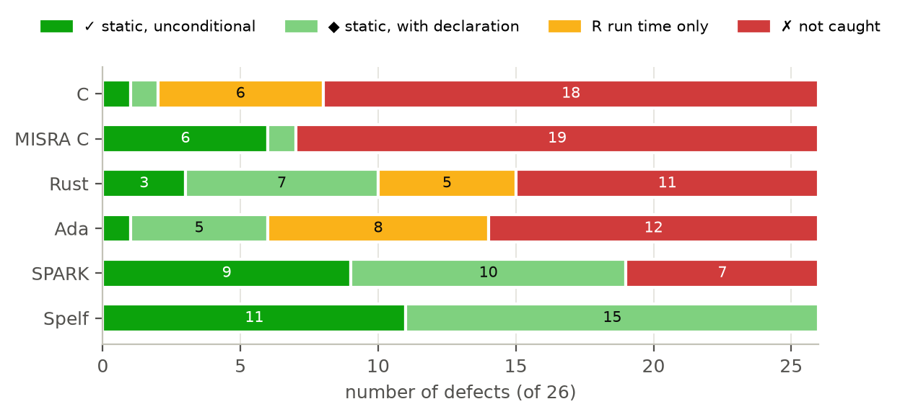
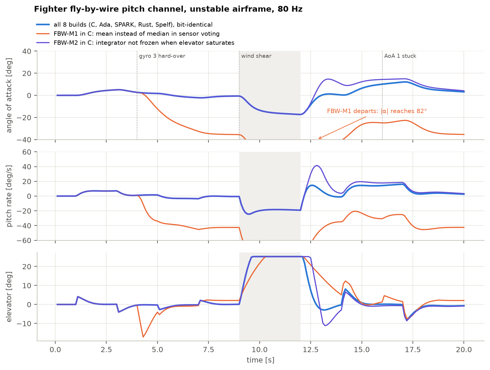
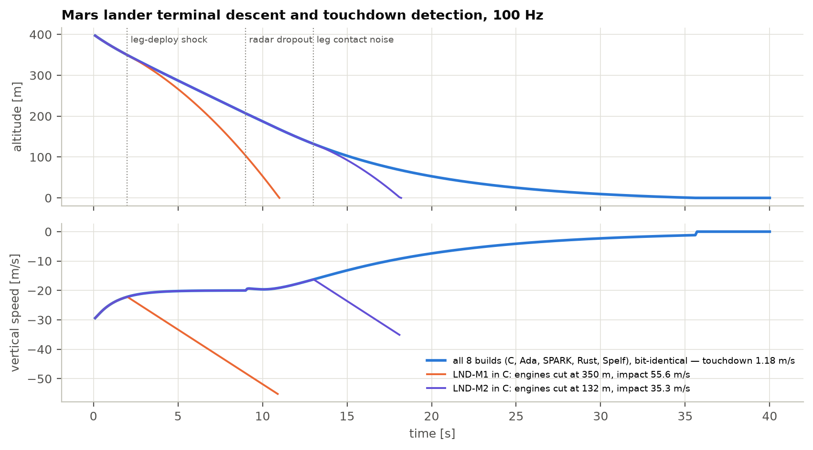
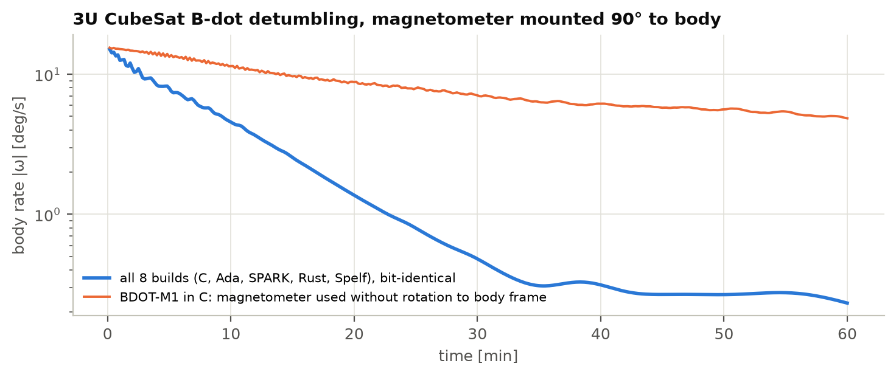
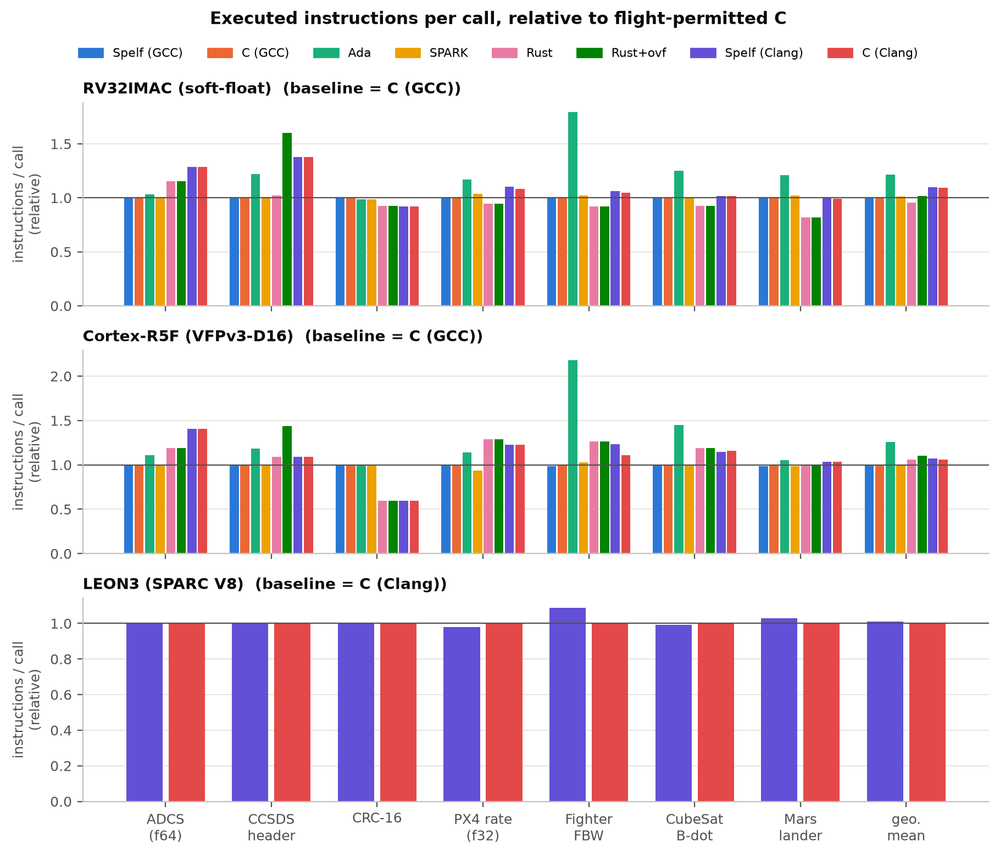
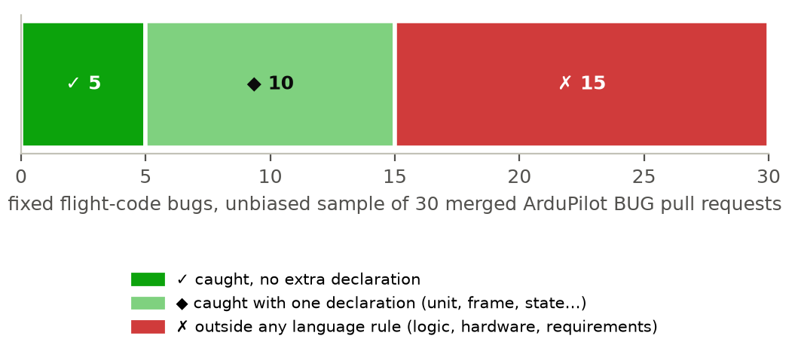

# Spelf

Spelf is a systems programming language for flight software: spacecraft, launchers, aircraft and the
onboard computers that fly them. It compiles to plain, undefined-behaviour-free C11 and it refuses to
compile a program unless it can prove, at compile time, every property that flight code usually checks
at run time or does not check at all.

The idea is narrow on purpose. Most of the software failures that have destroyed vehicles were not
deep algorithmic mistakes. They were a unit mixed up with another unit (Mars Climate Orbiter), a number
that no longer fitted in sixteen bits (Ariane 5), a vibration read as a landing (Mars Polar Lander), a
saturated sensor trusted as if it were healthy (Schiaparelli), a lock that inverted priorities (Mars
Pathfinder). Each of these is a fact the program knew, or could have known, and never wrote down in a
form a compiler could check. Spelf makes those facts part of the type of the value and then proves them.

This repository contains the language, a working prototype compiler (`spelfc`, Python + Z3), and the
complete benchmark that compares it with C, MISRA C, Ada, SPARK and Rust on real tools, real flight
targets and closed-loop simulations. The technical guide is in
**[Spelf-Guide.pdf](Spelf-Guide.pdf)**.

> Status: research prototype, version 0.16. The compiler is not qualified and should not fly anything.

---

## What it looks like

A touchdown detector for a Mars lander. A sensor reading is `Suspect<T>` and has to be matched before
it can be used; a value that came from a sensor can only change a persistent decision through a
`Latch` that states how many consecutive cycles it must persist.

```
type Alt = Float32<m, 0.0..=2500.0>;

state armed: Latch = latch(persists_for = 5);
state touchdown: Latch = latch(persists_for = 3);

fn engines_off(alt: Suspect<Alt>, l1: Suspect<bool>, l2: Suspect<bool>, l3: Suspect<bool>) -> bool {
  match alt {
    Valid(h) => feed(armed, h < 40.0[m]),
    _ => feed(armed, false),
  }
  feed(touchdown, is_set(armed) && contact(l1) + contact(l2) + contact(l3) >= 2);
  is_set(touchdown)
}
```

Write the Mars Polar Lander version instead, where a single leg contact sets a boolean, and the
compiler stops:

```
lander.spelf:32:15: error [R-404] a transient signal is being latched: persistent 'touchdown' is changed under a condition that comes from a sensor
    A transient signal (shock, EMI, SEU) cannot become a persistent decision without a declared persistence condition.
    Mars Polar Lander (1999): the leg-deploy shock was latched as 'touchdown', and the engines shut down at about 40 m.
    expected: state x: Latch = latch(persists_for = N); ... feed(x, condition);
```

The same program written in C, Rust and Ada compiles cleanly, passes GCC `-fanalyzer`, Cppcheck with
the MISRA addon and Clippy without a single new warning, and GNATprove proves the Ada version free of
run-time errors. In closed-loop simulation it shuts the engines off at 350 m and hits the ground at
55.6 m/s. Details below.

---

## Results

Everything in this section is produced by scripts in `benchmark/`, from real compilers and real
analysers, and can be regenerated with the commands under [Reproducing the results](#reproducing-the-results).
The raw data (`results.json`, `sil_complex_results.json`, ...) is committed next to the scripts.

### 1. Twenty-six accident-derived defects, six languages, real tool output

Each defect class (derived from a documented accident or incident) was written as a faulty program and a
fixed program in C, MISRA C, Rust, Ada, SPARK and Spelf, then run through the strongest checker each
language has: GCC with `-fanalyzer` and UBSan, Cppcheck 2.20 with the official MISRA addon, rustc 1.98 with
Clippy (pedantic), GNAT 16.1 with all run-time checks, GNATprove 16.1 at level 2. A cell only counts if the
faulty program is flagged *and* the fixed one is not.



| Language | caught statically | caught at run time | not caught |
|---|---|---|---|
| **Spelf** | **26** (11 unconditionally, 15 with one declaration) | 0 | **0** |
| SPARK | 19 | 0 | 7 |
| Rust | 10 | 5 | 11 |
| Ada | 6 | 8 | 12 |
| MISRA C | 7 | 0 | 19 |
| C | 2 | 6 | 18 |

"With one declaration" means the catch depends on something the programmer wrote and could have
omitted: a unit, a reference frame, a sensor source, an envelope. The same criterion is applied to every
language. If you leave the unit off a quantity, Spelf will not catch a unit error either. The full matrix
is in `benchmark/figures/mutant_matrix.png` and `benchmark/multilang/results.json`.

### 2. Complex systems in closed loop: a fighter, a satellite, a Mars lander

Three onboard controllers were written with identical algorithms and identical floating-point operation
order in C, Ada/SPARK, Rust and Spelf:

* **Fighter fly-by-wire pitch channel** for a statically unstable airframe at 80 Hz: triplex gyro and
  angle-of-attack voting, gain scheduling on dynamic pressure, an angle-of-attack limiter, PI with
  anti-windup, elevator rate limit.
* **CubeSat B-dot detumbling** at 10 Hz: magnetometer mounted at 90° to the body, rotation to body frame,
  filtered derivative, first-sample and invalid-sample logic.
* **Mars lander terminal descent** at 100 Hz: radar altitude with validity, a debounced touchdown detector
  armed below 40 m, a safe descent rate when the radar drops out.

Each controller runs against a physics model (C, double precision, RK4) on emulated flight processors:
RISC-V RV32IMAC, ARM Cortex-R5F and SPARC LEON3. The scenarios inject faults: a gyro hard-over, a wind
shear that saturates the elevator, a stuck angle-of-attack vane, a magnetometer dropout, the leg-deploy
shock that killed Mars Polar Lander, a radar dropout, contact noise. The same physics is also written in
Python and the controller run through the Spelf reference interpreter.

**54 of 54** language × processor × scenario runs produce trajectories that are bit-for-bit identical to
the Python reference. The languages differ only in what they let through.





Five real defect classes were then written into all four languages and the C version was flown in the
same scenario:

| Defect | Effect in closed loop (C) | GCC -fanalyzer | MISRA | Clippy | GNATprove | Spelf |
|---|---|---|---|---|---|---|
| Leg contact written straight to a flag (Mars Polar Lander) | engines cut at 350 m, impact 55.6 m/s | no warning | no warning | no warning | proved free of RTE | **rejected, R-404** |
| Invalid radar value used without its status (Schiaparelli lesson) | engines cut at 132 m, impact 35.3 m/s | no warning | unused-member note | no warning | proved free of RTE | **rejected, R-402** |
| Magnetometer used without rotation to body frame | still tumbling at 4.85°/s after one hour (reference 0.23°/s) | no warning | no warning | no warning | proved free of RTE | **rejected, 05§5.2** |
| Integrator not frozen when the elevator saturates | pitch-rate overshoot 41.5°/s after the gust (reference 14.6°/s) | no warning | no warning | no warning | proved free of RTE | **rejected, R-407** |
| Mean instead of median in sensor voting | loss of control, angle of attack 82° | no warning | no warning | no warning | proved free of RTE | accepted |

The last row is there on purpose. Averaging three gyros instead of taking the median is an algorithm
error; no type system can know which one you meant, and Spelf does not pretend to. GNATprove is correct
in every row: none of these programs overflows or leaves a range. They fail as control systems, which is
exactly the kind of failure that run-time-error freedom does not cover and Spelf's provenance, frame and
saturation rules do.

### 3. Cost: as fast as the C that is allowed to fly

The seven workloads (the three above plus an ADCS attitude controller, a CCSDS packet-header decoder, a
CRC-16 frame check and the PX4 multicopter rate controller) were compiled with GCC 16.1 (GNAT cross
toolchains), Clang and rustc, with flight flags, and the executed instructions per call counted exactly
in the emulator. **126 of 126** outputs are bit-identical to the reference semantics.



Geometric means over all workloads and processors, same compiler back end:

| Spelf compared with | instructions / call | code size | run-time checks left in the object |
|---|---|---|---|
| flight C, GCC (MISRA style, no checks) | 0.998 | 0.996 | Spelf 0, C 0 |
| SPARK after proof, checks suppressed | 0.996 | 0.944 | Spelf 0, SPARK 0 |
| Ada with run-time checks | **0.806** | **0.662** | Spelf 0, Ada 34 |
| flight C, Clang | 1.010 | 1.001 | Spelf 0, C 0 |
| Rust (release, no overflow checks) | 1.080 | 1.017 | Spelf 0, Rust 4 |
| Rust with overflow checks | 1.025 | 0.874 | Spelf 0, Rust 14 |

Spelf is not faster than unchecked C and cannot be: it generates C. The claim is that you pay nothing
for the proofs. The 8% gap to Rust comes from the toolchain and not from the language. On RV32, rustc
links its own software floating-point library while every other build uses Zig's `compiler-rt`, and C
compiled with the same Clang lands on exactly the same numbers as Spelf. On the Cortex-R5F, which has a
hardware FPU, Spelf and Rust are level. Instruction counts are not WCET; the emulator has no caches or
pipeline.

The distribution of instructions per call is in `benchmark/figures/per_call_histograms.png`, code size
in `size_relative.png`, residual checks in `residual_checks.png`.

### 4. Real bugs, not just accident replays

The defect corpus above is biased towards what Spelf was designed for. To measure the base rate, the 30
most recent merged ArduPilot pull requests labelled BUG that touch flight code were classified from their
descriptions (`benchmark/real-bugs/real_bugs.csv`):



Half of them fall under a Spelf rule, a sixth unconditionally. The other half are logic, requirement and
hardware errors, and no language rule would have caught them. The classification was done by the authors
of Spelf; the blind re-classification kit is described below.

### 5. Is the compiler itself right?

A verifier that is wrong is worse than no verifier. The prototype is checked in five independent ways:

* the soundness of the proof rules is mechanised in Z3: structural induction for the expression core,
  24 lemmas for the program logic (loops, modular calls, protected objects, interleavings, linear
  resources), each with a self-test that breaks the rule and must fail;
* every proof obligation is exported as SMT-LIB and re-checked by a second solver (cvc5);
* a reference interpreter with a semantic oracle runs every test program; its output is compared with the
  compiled C (31 of 31 programs identical);
* the generated code is compiled for LEON3, RV32 and Cortex-R5 and executed on emulators, then compared
  bit for bit with the interpreter (binary-level translation validation; 31 programs × 3 processors, 93 of
  93 identical);
* soundness fuzzers generate random programs and look for a proved property that fails at run time.

The guide describes what each of these does and does not establish.

---

## What Spelf does not do

* It does not prevent algorithm, requirement or hardware errors. Roughly half of real flight bugs are of
  that kind.
* It does not compute worst-case execution time. Task WCETs are declared; the compiler checks the task
  set is schedulable under those declarations and cross-checks stack depth on the target assembly.
* The prototype compiler is written in Python and is not qualifiable as a DO-178C / ECSS tool. The
  evidence bundle it emits is designed for that path; the path itself is future work.
* It is not faster than C. It is as fast as C that is allowed to fly.

---

## Quick start

Python 3.11 or newer.

```bash
python -m pip install -r compiler/requirements.txt
cd compiler
python -m spelfc check ../examples/04-sensors/touchdown.spelf
python -m spelfc run ../examples/03-frames/mounting.spelf
python -m spelfc build -o out.c ../examples/05-saturation/pi.spelf --freestanding
python -m spelfc evidence ../examples/05-saturation/pi.spelf
```

`check` proves every obligation and prints the proof report; `run` also generates C, compiles it for the
host and runs it; `build --freestanding` writes C for a target without an operating system; `evidence`
writes the SMT-LIB evidence bundle that `tools/recheck_evidence.py` re-solves with Z3 and cvc5.

The `examples/` directory has short programs and a file, `examples/mutations.json`, with 15 entries of
this form:

```json
{
 "file": "03-frames/mounting.spelf",
 "change": "rotate<BodyV>(MAG_TO_BODY, m)",
 "to": "BodyV { x: m.x, y: m.y, z: m.z }",
 "rejected_by": "05§5.2"
}
```

Each entry says: make this change and the compiler rejects the program with this rule.
`python examples/check_examples.py` applies every one of them and fails if any claim is false.

| Example | What it shows |
|---|---|
| `01-units` | units of measure, explicit exact conversion (Mars Climate Orbiter) |
| `02-narrowing` | ranges and proved narrowing (Ariane 501) |
| `03-frames` | reference frames and checked rotations |
| `04-sensors` | `Suspect<T>`, `Latch`, provenance of persistent decisions (Mars Polar Lander) |
| `05-saturation` | `saturate`, anti-windup, an integrator that provably stays in range without a clamp |
| `06-tasks` | protected objects, data races, response-time analysis |
| `07-px4-rate-control` | the PX4 multicopter rate controller, ported line for line |
| `08-ccsds-header` | CCSDS space packet primary header with a wire encoding proved both ways |

The flight workloads used in the benchmark are in `benchmark/spacecraft/src/` in all four languages.

---

## The language in one table

| Rule | What the compiler proves or enforces |
|---|---|
| R-501 | every integer operation stays in its declared range; every narrowing fits; no division by zero; IEEE-754 floating point modelled exactly (binary32 and binary64, round to nearest even) |
| 02 §2.5 | every array index is in bounds |
| 05 §5.2 | units and scales agree (lbf·s is not N·s); vectors in different frames do not mix; frames change only through a declared rotation that is checked to be a rotation |
| R-402, R-403 | a sensor value is `Suspect<T>` and must be matched; a value derived from a sensor enters persistent state only through `Held<T>` with a maximum age |
| R-404 | a sensor-derived condition changes a persistent decision only through a `Latch` with a declared persistence |
| R-407 | a saturated command is `Clamped(v)` or `Unclamped(v)`; the program must say what happens in each case |
| R-505 | representation invariants (for example a canonical quaternion with w ≥ 0) hold for every value built |
| R-201 | no recursion without a declared bound; stack depth proved from the target assembly |
| R-203, R-205 | linear typestate for resources and DMA buffers; cache maintenance derived, not hand-written |
| 03 §3.3 | state shared between tasks lives in protected objects; data races do not compile |
| R-304, R-305, R-307 | response-time analysis with ICPP blocking, mode changes and slow-clock scenarios; watchdog feeding proved |
| R-412, R-413 | voters read the declared channel count; tolerances are justified against drift and rate |
| R-606 | dead code proved dead is reported |

Each rule, its motivation, the exact obligation it generates and its known limits are in the guide.

---

## Reproducing the results

| Tool | Used for | Install |
|---|---|---|
| Python ≥ 3.11 | spelfc and all scripts | python.org |
| `pip install -r compiler/requirements.txt unicorn matplotlib` | Z3, cvc5, Zig (cross C compiler), emulator, figures | |
| GCC ≥ 13 | the C static column (`-fanalyzer`) | distribution package or MinGW-w64 |
| Cppcheck 2.x | the MISRA C column | cppcheck.sourceforge.io, then `python benchmark/multilang/tools/fetch_misra_addon.py` |
| Rust (rustup) + Clippy | the Rust columns | `rustup component add clippy`; `rustup target add riscv32imac-unknown-none-elf thumbv7r-none-eabihf` |
| GNAT, GNATprove | the Ada and SPARK columns | Alire: `alr toolchain --select gnat_native gprbuild`, `alr install gnatprove`, plus `gnat_arm_elf` and `gnat_riscv64_elf` for the cross builds |

```bash
cd compiler
python tests/run_tests.py
python tests/diff_test.py
python tests/tools_test.py
python tools/xval_unicorn.py --tests

cd ../benchmark/multilang && python run.py && python report.py
cd ../spacecraft && python run.py && python sil.py && python sil_complex.py && python report.py
cd ../figures && python make_figures.py
```

The four test scripts cover, in order: accept and reject tests (`tests/expectations.json` holds what
each test program must do), interpreter against generated C, the toolchain (evidence bundle, stack,
memory regions, runtime substrates, mechanised lemmas), and the generated code executed on LEON3, RV32
and Cortex-R5 emulators. `run.py` in `spacecraft` takes about fifteen minutes; GNATprove dominates. On Windows, start Python
directly (`python.exe`), not through the Microsoft Store launcher, which hides the Alire toolchains.

---

## Repository layout

```
compiler/            spelfc: lexer, parser, checker (proof obligations), interpreter, C generator,
                     runtime substrates (bare metal, RTEMS 6), tools, tests
examples/            short programs and mutations.json, the machine-checked rejections
benchmark/
  multilang/         26 defects x 6 languages, real tool output
  spacecraft/        7 flight workloads in C, Ada/SPARK, Rust, Spelf; emulation; closed-loop SIL
  spark-prototype/   how far the same guarantees can be pushed inside SPARK with a library
  real-bugs/         classified ArduPilot and PX4 bug fixes
  independent-evaluation/  blind classification sheet
  figures/           every figure in this README, regenerated from the raw data
Spelf-Guide.pdf      the technical guide
```

---

## Independent evaluation

Every number above was produced by the people who designed Spelf. That is the weakest point of the
whole project and the most useful thing anyone can do is to test it without us. Three tasks, each a few
hours to a day:

1. **Blind bug classification.** `benchmark/independent-evaluation/bugs-blind.csv` lists 30 ArduPilot
   pull requests in shuffled order without our verdicts. Classify each as caught unconditionally,
   caught with one declaration, or not catchable by any language rule, using the rule table above.
   Then compare with `benchmark/real-bugs/real_bugs.csv` and report agreement and Cohen's κ.
2. **Rewrite the competitors.** Rewrite the C, Ada/SPARK and Rust programs in
   `benchmark/multilang/programs_*.py` your own way, without looking at ours, and rerun the matrix. Every
   cell that changes tells us either that our program was weak or that yours uses a stronger mechanism.
3. **Beat the performance claim.** Make the C, Ada or Rust version of a workload in
   `benchmark/spacecraft/src/` faster or smaller while producing the same output bits (`run.py` checks).

A result that contradicts ours, published or filed as an issue, is worth more to us than two that agree.

---

## Contributing

Issues and pull requests are welcome. A change to a language rule needs evidence: a test in
`compiler/tests/features/` that the old rule gets wrong and the new one gets right, and all suites green.
Benchmark changes must keep the raw data and the figures reproducible from scripts.

## License and citation

Copyright 2026 Burak. Licensed under the Apache License 2.0; see `LICENSE` and `NOTICE`. Third-party tools used by the benchmark (Cppcheck's MISRA
addon, GNAT, GNATprove, Rust, Z3, cvc5, Zig, Unicorn) are not distributed here. If you use Spelf or the
benchmark in research, `CITATION.cff` has the citation.
